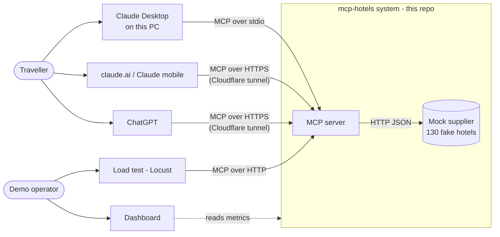
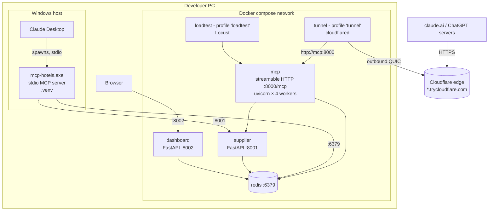
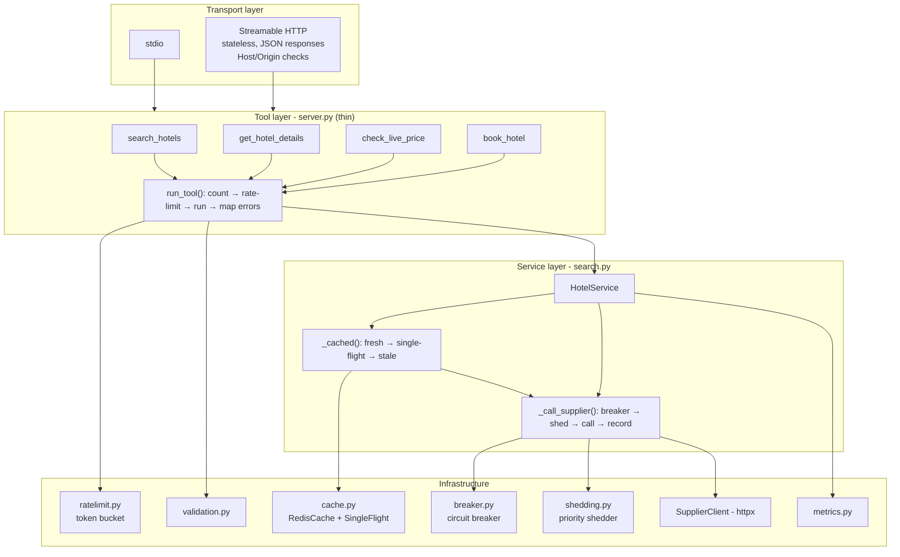
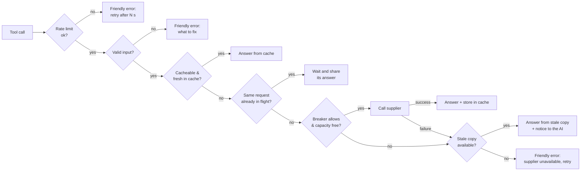
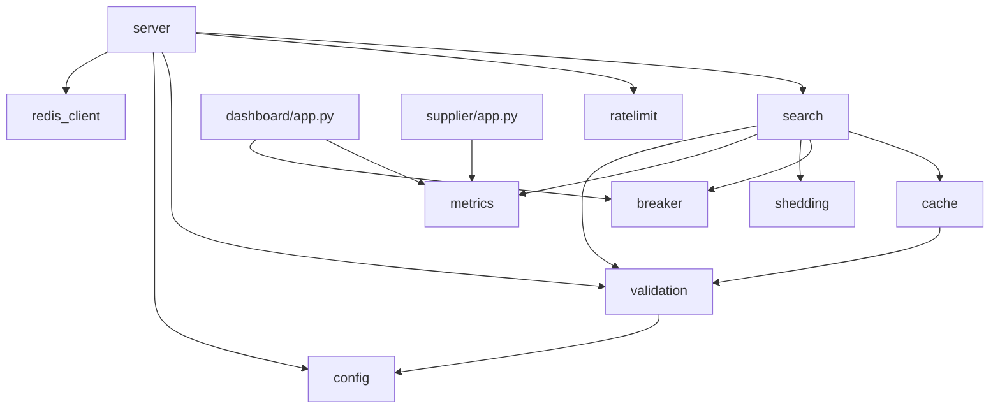
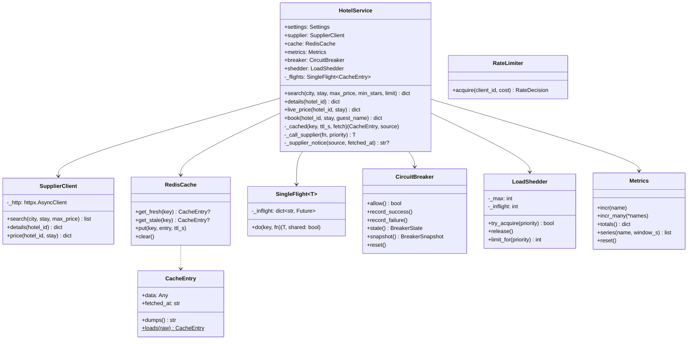
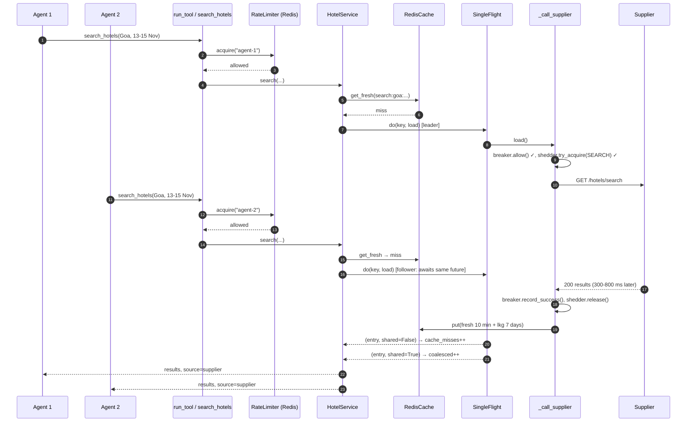
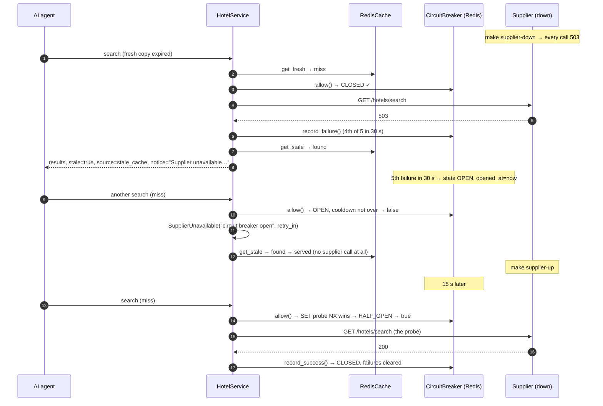
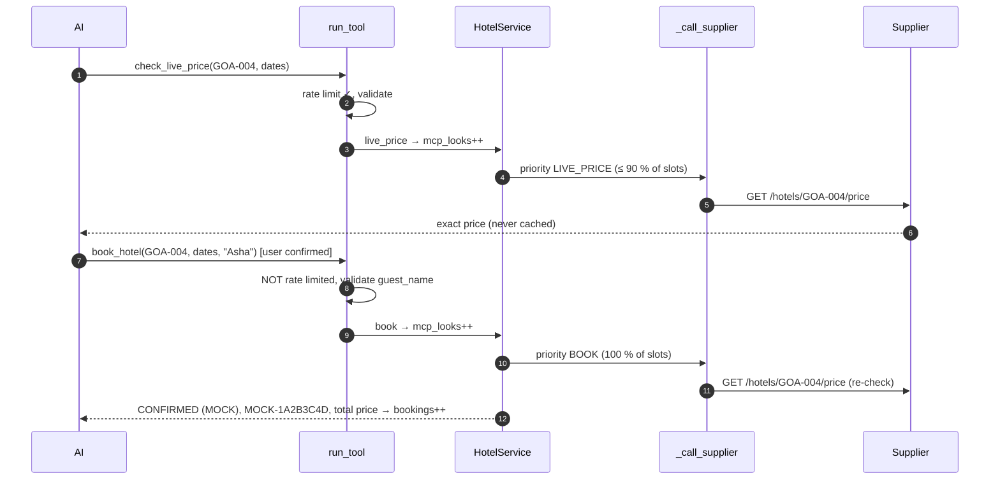
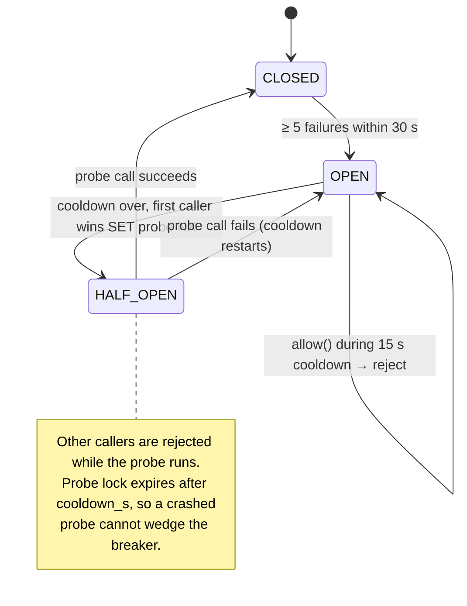

# Architecture: mcp-hotels

How the system is put together, at two levels:

- **Part A, High-Level Design (HLD):** the parts, how they connect, and why it is shaped this way.
- **Part B, Low-Level Design (LLD):** modules, classes, request flows, data formats, algorithms
  and configuration, precise enough to change the code safely.

> All hotel data is **mock**. Nothing in this system calls a real travel site or API.
> Diagrams are [Mermaid](https://mermaid.js.org/); they render in VS Code (Markdown preview,
> `Ctrl+Shift+V`) and on GitHub.

Related docs: [CONCEPTS.md](CONCEPTS.md) (the ideas in plain words) ·
[FILES.md](FILES.md) (every file) · [RUNBOOK.md](RUNBOOK.md) (commands).

---

# Part A: High-Level Design

## A1. Problem and goals

An online travel company wants AI assistants (Claude, ChatGPT…) to search its hotel inventory.
AI traffic is different from human traffic:

- It arrives in **bursts**: many agents ask the same popular question at the same moment.
- It produces many **looks** (searches, price checks) per **book**. Suppliers charge for, or
  throttle, a high look-to-book ratio.
- The upstream **supplier is slow** (300–800 ms) and **sometimes fails**.

| # | Goal | How it is met |
|---|---|---|
| G1 | Natural-language hotel search from any AI assistant | Standard **MCP** server with 4 well-described tools |
| G2 | Stay fast and stable under AI traffic spikes | Redis **cache**, request **coalescing**, per-client **rate limits**, multi-worker HTTP |
| G3 | Degrade gracefully when the supplier fails | **Circuit breaker** + **stale (last-known-good) cache** + **priority load shedding** |
| G4 | Keep the look-to-book ratio low | Cache and coalescing absorb repeated looks; only misses reach the supplier |
| G5 | Make all of it visible | Shared **metrics** in Redis + live **dashboard** |

**Non-goals:** real inventory, real payments, user accounts, authentication on the public
tunnel (see A8).

## A2. System context

Who talks to the system, and what is outside it.



## A3. Containers and deployment

Everything runs on one Windows PC: four long-running containers in Docker, two optional ones,
and one process started by Claude Desktop.



| Container | Image / command | Port | Role |
|---|---|---|---|
| `redis` | `redis:7-alpine` | 6379 | Shared state: cache, rate buckets, breaker, metrics |
| `supplier` | `uvicorn supplier.app:app` | 8001 | Mock upstream inventory (slow, can be made to fail) |
| `mcp` | `mcp-hotels --http` (4 workers) | 8000 | The MCP server for remote clients and the load test |
| `dashboard` | `uvicorn dashboard.app:app` | 8002 | Live metrics page + JSON API |
| `tunnel` *(optional)* | `cloudflare/cloudflared:2026.10.0` | none | Public HTTPS URL → `mcp:8000` |
| `loadtest` *(optional)* | `locustio/locust:2.47.0` | none | Simulated AI traffic spike |

**Key point:** the stdio server (Claude Desktop) and the HTTP server (Docker) are two
*separate* processes running the *same* code, and they share all state through Redis. A
breaker opened by one is open for the other, and the dashboard counts both.

## A4. Logical components (inside the MCP server)



## A5. The four tools

| Tool | Purpose | Cached? | Rate-limited? | Supplier priority | Annotation |
|---|---|---|---|---|---|
| `search_hotels` | Hotels in a city for dates, cheapest first | Yes, 10 min (+7-day stale copy) | Yes | SEARCH (lowest) | read-only |
| `get_hotel_details` | Amenities, area, description | Yes, 24 h (+7-day stale copy) | Yes | SEARCH | read-only |
| `check_live_price` | Exact current price before booking | **Never** | Yes | LIVE_PRICE | read-only |
| `book_hotel` | Mock booking (fake confirmation id) | **Never** | **No** (revenue) | BOOK (highest) | not read-only |

Typical AI flow: `search_hotels` → (optional) `get_hotel_details` → `check_live_price` → user confirms → `book_hotel`.

## A6. Request lifecycle (high level)



## A7. Key design decisions

| Decision | Why | Trade-off accepted |
|---|---|---|
| **All shared state in Redis** (cache, buckets, breaker, metrics) | stdio + HTTP processes and N workers must agree; servers stay stateless and scalable | Redis is a dependency. Mitigated: every Redis error degrades to "miss / allow / skip" |
| **Stateless streamable HTTP** + JSON responses | Any worker can serve any request; no sticky sessions; simple for proxies and load tests | No server-initiated streaming / notifications (not needed here) |
| **Two cache copies:** fresh (short TTL) and last-known-good (7 days) | Normal answers are recent; during an outage we can still answer, clearly labelled `stale` | Stale prices can be wrong, so the AI is told to confirm with `check_live_price` |
| **Single-flight coalescing** (in-process) | 100 identical concurrent misses → 1 supplier call | Per process: with 4 workers, up to 4 calls per hot key (Redis lock would make it 1, at extra latency) |
| **Circuit breaker in Redis** with a single half-open probe | Stop hammering a failing supplier; recover automatically with one test call | 15 s of cache-only answers after an outage even if the supplier recovers sooner |
| **Priority load shedding** (search 60 % / live price 90 % / book 100 % of slots) | When the supplier is saturated, keep room for revenue | Searches may get stale results or a "busy" error under extreme load |
| **Bookings never rate-limited or cached** | They are the business; they must always use a live price | A misbehaving client could spam bookings (mock only; production would need auth) |
| **Friendly `ToolError`s, no tracebacks** | The AI can read and act on them; log storms during spikes pinned the CPU at 100 % | Less detail in logs (one warning line per unexpected error) |
| **Thin tool layer** (`server.py`) over `HotelService` | Business logic testable without MCP; tools stay readable for the model | One extra indirection |

## A8. Quality attributes

| Attribute | Approach | Evidence |
|---|---|---|
| **Performance** | Cache, coalescing, 4 uvicorn workers, Redis `BlockingConnectionPool` (200) | Spike to 500 simulated agents: ~500 req/s, search p50 ≈ 12 ms, 0 requests shed (dev PC) |
| **Availability** | Breaker + stale cache + shedding; fail-open on Redis errors | `make scenario`: supplier taken down mid-spike, searches keep answering from cache, breaker recovers |
| **Fairness** | Token bucket per client (burst 30, 10/s) | Noisy-bot clients get rate-limited; others don't |
| **Cost (look-to-book)** | Only cache misses reach the supplier | Dashboard shows ratio *with* vs *without* cache |
| **Observability** | Redis counters (totals + per-second), dashboard, optional access log | http://localhost:8002 |
| **Security** | DNS-rebinding protection (Host + Origin allow-lists), input validation, no secrets in code | **Public tunnel has no auth**: acceptable only because all data is mock |
| **Testability** | Pure-Python service layer; `fakeredis` + `FakeSupplier`; injectable clocks | 26 pytest tests |

## A9. From demo to production (what would change)

| Area | Demo | Production direction |
|---|---|---|
| Auth | None on the tunnel | OAuth 2.1 for remote MCP (the protocol supports it), per-partner API keys for rate limits |
| Hosting | One PC + quick tunnel | Container platform behind a load balancer; autoscale MCP pods on RPS |
| Redis | Single container | Managed Redis with replicas; separate instances for cache vs. control state |
| Coalescing | In-process | Plus a short Redis lock for very hot keys across pods |
| Breaker | One supplier | One breaker per supplier / per region; bulkheads per supplier |
| Data | 130 fake hotels | Real inventory APIs, pricing rules, availability; price-change tolerance on booking |
| Observability | Redis counters | OpenTelemetry traces, Prometheus metrics, alerts on breaker-open and look-to-book |

---

# Part B: Low-Level Design

## B1. Code layout and dependencies

```
mcp_server/
  server.py        MCP tools, run_tool(), client identity, HTTP app factory, CLI entry (main)
  search.py        HotelService, SupplierClient, error types, response shaping
  cache.py         CacheEntry, key builders, RedisCache, SingleFlight
  breaker.py       CircuitBreaker (Redis-backed)
  ratelimit.py     RateLimiter (Redis Lua token bucket)
  shedding.py      Priority, LoadShedder
  metrics.py       counter names + Metrics (Redis)
  validation.py    normalize_city / validate_stay / normalize_hotel_id
  config.py        Settings (env vars), SUPPORTED_CITIES, CITY_ALIASES
  redis_client.py  make_redis(): shared BlockingConnectionPool
supplier/app.py    mock supplier (FastAPI) + data/hotels.json
dashboard/app.py   metrics API + index.html
```

Module dependency direction (no cycles; lower layers never import higher ones):



## B2. Class diagram



Singletons (the only global mutable state): `SERVICE` (`_ServiceHolder` in `server.py`,
built lazily on first tool call so both stdio and every HTTP worker get their own instance)
and `STATE` in the supplier (down flag + failure rate).

## B3. Tool layer: `run_tool()`

Every tool body is wrapped the same way:

1. `incr_many(mcp_requests, mcp_requests:<tool>)`.
2. If the tool is in `RATE_LIMITED_TOOLS` (everything except `book_hotel`):
   `RateLimiter.acquire(client_id)`. If denied, the pending coroutine is closed (never run),
   `rate_limited` is counted, and a `ToolError("Rate limited… Retry after N s")` is raised.
3. Await the tool's coroutine (validation runs inside it).
4. Map exceptions to friendly `ToolError`s:

| Exception | Message to the AI |
|---|---|
| `InvalidInput` | The validation message as-is (e.g. *"check_out must be after check_in."*) |
| `HotelNotFound` | *"No hotel with that id. Use search_hotels to find valid ids (e.g. 'GOA-001')."* |
| `SupplierUnavailable` (breaker/shed) | Tool-specific text + reason + *"Retry after N s."* |
| `SupplierError` (5xx/timeout) | Tool-specific text + *"Please try again shortly."* |
| any other `Exception` | One `WARNING` log line; *"Temporary internal error - please retry in a moment."* |

**Client identity** (`client_id_from`), first match wins: `X-Client-Id` header →
`mcp-session-id` → `cf-connecting-ip` (real caller behind the tunnel) → socket IP → `"stdio"`.

## B4. Sequence: search, cache miss with coalescing

Two AI agents ask the identical question at the same moment; the supplier is called once.



A third agent arriving later within 10 minutes gets `get_fresh` → hit → `cache_hits++`,
`source=cache`, with no supplier call.

## B5. Sequence: supplier outage



If there is **no** stale copy (a search nobody has made in the last 7 days), the AI gets
*"No cached results exist for this exact search and the supplier can't be reached (…). Retry
after N s."*

## B6. Sequence: live price and booking



## B7. Circuit breaker state machine



Implementation details:

- Failures are a Redis **sorted set** scored by timestamp; each failure trims entries older
  than the window and counts the rest in one `MULTI` pipeline (sliding window).
- Only a success **in HALF_OPEN** closes the breaker. A slow call that started before the
  breaker opened and succeeds late is not proof of recovery.
- `HotelNotFound` (404) counts as a **success**: the supplier answered.
- All public methods **fail open** on `RedisError` (allow the call, don't record).

## B8. Rate limiter: token bucket (Lua)

Per client key `mh:rl:<client_id>` (a hash `{tokens, ts}`), executed atomically in Redis:

```
tokens = min(capacity, tokens + (now - ts) × refill_per_s)
if tokens ≥ cost: tokens -= cost → allowed
else:             retry_after = (cost - tokens) / refill_per_s → denied
HSET tokens, ts ; EXPIRE key ceil(capacity / rate) + 5
```

Defaults: capacity (burst) **30**, refill **10 tokens/s**. Running the read-refill-take step as
one Lua script means concurrent requests from the same client can't overspend. If Redis is
unreachable, `acquire` **fails open** (allows).

## B9. Load shedder

In-process counter of concurrent supplier calls, `max_inflight = 40` per process:

| Priority | Share | Max concurrent (of 40) |
|---|---|---|
| `SEARCH` (search, details) | 60 % | 24 |
| `LIVE_PRICE` | 90 % | 36 |
| `BOOK` | 100 % | 40 |

`try_acquire(priority)` rejects when `inflight ≥ limit_for(priority)`; `release()` runs in a
`finally`. A shed search raises `SupplierUnavailable` and so still falls back to the stale copy.

## B10. SingleFlight

```python
async def do(key, fn) -> (value, shared):
    if key in inflight: return await shield(inflight[key]), True   # follower
    inflight[key] = new Future                                      # leader
    try:    result = await fn(); future.set_result(result); return result, False
    except: future.set_exception(exc) (or cancel); raise
    finally: inflight.pop(key)
```

- `asyncio.shield` makes sure a follower whose client disconnects never cancels the leader's work.
- An error is shared too: all followers see the leader's `SupplierError`, and each then
  tries the stale copy.

## B11. Data design

### Redis keys

| Key | Type | TTL | Written by | Content |
|---|---|---|---|---|
| `mh:c:fresh:search:<city>:<in>:<out>:g<guests>:p<max\|any>` | string (JSON) | 600 s | MCP | `{"data": [hotels], "fetched_at": iso}` |
| `mh:c:fresh:hotel:<ID>` | string (JSON) | 86 400 s | MCP | hotel details |
| `mh:c:lkg:<same suffix>` | string (JSON) | 604 800 s (7 d) | MCP | last-known-good copy |
| `mh:rl:<client_id>` | hash | ~8 s | MCP (Lua) | `tokens`, `ts` |
| `mh:breaker:supplier` | hash | none | MCP | `state`, `opened_at` |
| `mh:breaker:supplier:failures` | zset | 60 s | MCP | failure timestamps |
| `mh:breaker:supplier:probe` | string | 15 s | MCP | half-open probe lock |
| `mh:m:total:<counter>` | int | none | MCP, supplier | running total |
| `mh:m:sec:<counter>:<epoch_s>` | int | 300 s | MCP, supplier | per-second bucket |

Note: `min_stars` and `limit` are **not** in the search key. They are applied after the
cache, so "Goa under ₹6,000" serves every star filter and page size from one entry.

### Hotel record (`supplier/data/hotels.json`)

```json
{ "id": "GOA-004", "name": "The Sands Suites", "city": "Goa", "area": "Baga",
  "stars": 4, "rating": 4.6, "base_price_inr": 4250,
  "amenities": ["…"], "description": "The Sands Suites is a 4-star property in Baga, Goa, rated 4.6 by guests." }
```

130 hotels = 13 cities × 10, generated deterministically by `scripts/gen_hotels.py` (seed 42).
IDs are `<CODE>-NNN` (GOA, MAN, JAI, UDA, KOC, RIS, PDY, TVM, OOT, MNR, SML, DJL, CRG).

### Supplier pricing (`quote()`, computed per request, never stored)

```
per night = base_price × Fri/Sat 1.25 × (December: 1.70 from the 24th, else 1.35)
          × (1 + 0.15 × max(0, guests − 2)) × (1 ± 3 % noise)
total     = sum over nights
```

### Tool response: `search_hotels`

```json
{
  "city": "Goa", "check_in": "2026-11-13", "check_out": "2026-11-15", "nights": 2, "guests": 2,
  "results": [ { "id": "GOA-004", "name": "The Sands Suites", "area": "Baga", "stars": 4,
                 "rating": 4.6, "price_per_night_inr": 5364, "total_price_inr": 10728,
                 "price_as_of": "2026-11-12T15:02:11+00:00", "stale": false } ],
  "total_matches": 7, "stale": false, "source": "cache",
  "notice": "(only when stale or the breaker is not closed)"
}
```

`source` ∈ `supplier` (fetched now, or shared via coalescing) · `cache` (fresh hit) ·
`stale_cache` (last-known-good during an outage).

## B12. Supplier API (mock)

| Method & path | Purpose | Counts a look? |
|---|---|---|
| `GET /health` | `{ok, hotels, down, failure_rate}` | no |
| `GET /hotels/search?city&check_in&check_out&guests&max_price` | Matching hotels with quotes, cheapest first | yes |
| `GET /hotels/{id}` | Details (no base price) | no |
| `GET /hotels/{id}/price?check_in&check_out&guests` | Exact quote | yes |
| `POST /admin/failure-rate {rate}` | Fail that fraction of calls with 503 | no |
| `POST /admin/down` · `POST /admin/up` | Total outage on/off (`up` also resets the rate) | no |

A middleware adds 300–800 ms latency to every call, then applies `down` / `failure_rate`.

## B13. Dashboard API

`GET /api/metrics` returns `totals` (all counters), a per-second `series` for the last 90 s (`DASHBOARD_WINDOW_S`),
`now` (5-second averages: MCP req/s, supplier looks/s, rate-limited/s), `cache`
(hit rate, share served without the supplier), `look_to_book` (ratio with and without the
cache) and `breaker` (state, recent failures, seconds to retry). `POST /api/reset` zeroes
the counters. The page polls every second and draws with Chart.js.

**Look-to-book** is computed as:
- *without cache* = `mcp_looks / bookings` (every search + price check the AIs made)
- *with cache* = `supplier_looks / bookings` (what actually reached the supplier)

## B14. Transport and security

- `mcp.streamable_http_app(stateless_http=True, json_response=True)`, served at `/mcp` by
  uvicorn with `MCP_WORKERS` processes (default 4 in Docker). Built by the factory
  `http_app()` so each worker builds its own app.
- **DNS-rebinding protection:** `Host` must match `MCP_ALLOWED_HOSTS`
  (`localhost:*,127.0.0.1:*,mcp:*`); the tunnel rewrites Host to `mcp:8000`. `Origin`, if
  present, must be `http://<allowed host>` or one of `MCP_ALLOWED_ORIGINS` (claude.ai,
  claude.com, chatgpt.com, chat.openai.com via `.env`); otherwise 403.
- **Tool annotations:** search, details and live price are `readOnlyHint=true`; booking is
  `readOnlyHint=false, destructiveHint=false`. Clients use these to decide when to ask the user.
- **stdio:** logs go to stderr only (stdout carries the protocol).
- **Logging:** plain `logging` (not Rich), MCP SDK at WARNING, optional one-line access log
  (`MCP_ACCESS_LOG=true`).

## B15. Configuration (env vars, defaults)

| Variable | Default | Used by |
|---|---|---|
| `REDIS_URL` | `redis://localhost:6379/0` | all |
| `SUPPLIER_URL` | `http://localhost:8001` | MCP |
| `SUPPLIER_TIMEOUT_S` | 3.0 | MCP → supplier HTTP timeout |
| `CACHE_SEARCH_TTL_S` / `CACHE_DETAILS_TTL_S` / `CACHE_STALE_TTL_S` | 600 / 86 400 / 604 800 | cache |
| `RATE_LIMIT_BURST` / `RATE_LIMIT_PER_S` | 30 / 10 | token bucket |
| `BREAKER_FAILURE_THRESHOLD` / `BREAKER_WINDOW_S` / `BREAKER_COOLDOWN_S` | 5 / 30 / 15 | breaker |
| `SUPPLIER_MAX_INFLIGHT` | 40 | shedder (per process) |
| `MCP_HTTP_HOST` / `MCP_HTTP_PORT` / `MCP_WORKERS` | 127.0.0.1 / 8000 / 1 (Docker: 0.0.0.0, 4) | HTTP |
| `MCP_ALLOWED_HOSTS` / `MCP_ALLOWED_ORIGINS` | see B14 | HTTP security |
| `MCP_ACCESS_LOG` | false | HTTP logging |
| `SUPPLIER_LATENCY_MIN_MS` / `_MAX_MS` / `SUPPLIER_PRICE_NOISE` | 300 / 800 / 0.03 | supplier |
| `SPIKE_USERS` / `SPIKE_RAMP_S` / `SPIKE_HOLD_S` | 500 / 20 / 60 | load test |

## B16. Failure modes

| Failure | Behaviour | User/AI sees |
|---|---|---|
| Supplier slow | Calls wait up to 3 s; coalescing keeps concurrency low | Slower first answer, fast repeats |
| Supplier errors / down | Breaker opens after 5 failures in 30 s | Cached results marked `stale` with a notice; live price/booking fail with "retry after N s" |
| Supplier saturated | Shedder refuses searches first | Stale copy or "server busy"; bookings still go through |
| One client floods | Its token bucket empties | That client gets "Rate limited… retry after N s"; others unaffected |
| Redis down | Cache = miss, rate limit = allow, breaker = allow, metrics skipped | Everything still works, just slower and without protection |
| MCP worker crashes | uvicorn restarts it; other workers keep serving | Possibly one failed request |
| Tunnel down | Remote connectors can't reach the server | Claude Desktop (stdio) unaffected |
| Bad input | `InvalidInput` → friendly message | e.g. *"Sorry, 'Paris' isn't covered. Supported cities: …"* |

## B17. Testing

| Test file | Covers |
|---|---|
| `tests/test_cache.py` | Single-flight (one call for identical requests, separate keys, shared error then retry, cancelled follower), fresh+stale writes, search key, spike → 1 supplier call, filters after cache, live price never cached, details cached, booking counter, city aliases, data integrity |
| `tests/test_resilience.py` | Breaker: opens at threshold, sliding window, exactly one probe, probe success/failure, late success ignored. Token bucket: burst then limit, never above capacity. Shedder priorities. Stale fallback when supplier down or breaker open; error when no stale copy |

Run with `uv run pytest -q`. Tests use `fakeredis` (with Lua) and a `FakeSupplier`, with
injected clocks, so they run in about 1.5 s with no Docker. End-to-end checks: `make smoke`
(all tools over HTTP), `make scenario` (outage + recovery), `make spike` (load).
