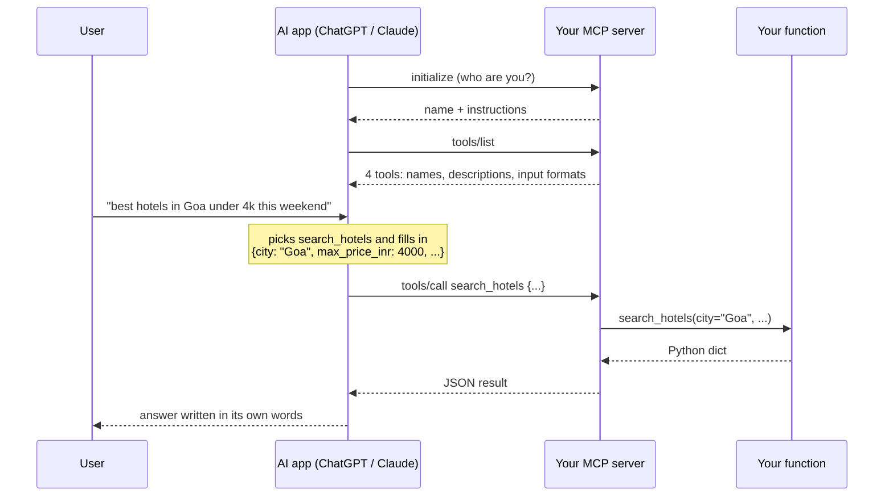

# MCP guide: how this project uses MCP, and how to build your own

This guide explains **where MCP lives in mcp-hotels**, **what happens when an AI uses it**,
and **how to build the same thing for a different application**, starting from a working
template in [`examples/minimal_server.py`](../examples/minimal_server.py).

Related docs: [CONCEPTS.md](CONCEPTS.md) (ideas in plain words) ·
[ARCHITECTURE.md](ARCHITECTURE.md) (full design) · [RUNBOOK.md](RUNBOOK.md) (commands).

---

## 1. The idea in one paragraph

**MCP (Model Context Protocol)** is a standard way for an AI app (Claude, ChatGPT, …) to
ask a program two things: *"what can you do?"* and *"please do this."* Your program answers
with a list of **tools** (each a name, a description and the inputs it takes), and runs a
tool when the AI calls it. Because it is a standard, **one MCP server works with every AI
app that supports MCP**. You don't build separate integrations for Claude and ChatGPT.

Think of MCP as the **front door** of your application. Your real logic (search, pricing,
booking) sits behind that door and does not need to know anything about MCP.

---

## 2. Where MCP is handled in this project

**In one file: `mcp_server/server.py`.** Everything else is ordinary Python.

```
  AI app (Claude / ChatGPT)
        │  MCP protocol (JSON messages)
        ▼
┌─────────────────────────────────────────────┐
│ server.py: the MCP front door               │  ← the ONLY MCP-specific code
│   • create the server (name, instructions)  │
│   • 4 tools = 4 Python functions            │
│   • transport: stdio or HTTP                │
└─────────────────────────────────────────────┘
        │  normal Python function calls
        ▼
┌─────────────────────────────────────────────┐
│ search.py: business logic (HotelService)    │  ← no MCP here
│ cache / breaker / ratelimit / shedding /    │
│ metrics / validation                        │  ← reusable in any app
└─────────────────────────────────────────────┘
        │  HTTP
        ▼
   supplier (your data source)
```

The four MCP pieces in `server.py`:

| Piece | Where | What it does |
|---|---|---|
| **Create the server** | `mcp = MCPServer(name=…, title=…, instructions=…)` | The **instructions** are the first thing the AI reads about your app: what it covers and how to use it |
| **Define tools** | `@mcp.tool(...)` above `search_hotels`, `get_hotel_details`, `check_live_price`, `book_hotel` | Each tool is an `async def` function. Its **typed parameters** become the input format the AI must follow; its **description** tells the AI when and how to use it |
| **stdio transport** | `mcp.run("stdio")` in `main()` | For Claude Desktop: it starts your program and talks to it through stdin/stdout |
| **HTTP transport** | `http_app()` → `mcp.streamable_http_app(...)` | For remote connectors (claude.ai, Claude mobile, ChatGPT): serves `POST /mcp` |

Also in `server.py`, but not MCP itself:
- `run_tool()`: wraps every tool: counts it, rate-limits it, and turns internal errors into
  friendly `ToolError` messages the AI can act on.
- `client_id_from()`: works out who is calling (for per-client rate limits).

**What the MCP SDK does for you** (the `mcp` Python package): the handshake, answering
"list your tools", checking the AI's arguments against your type hints, calling your
function, and sending back your result or error. **You never write protocol code.**

---

## 3. What happens when an AI uses your server



Two things to notice:
1. **The AI decides from text alone.** The instructions and tool descriptions it receives
   in steps 1–2 are all it knows about your server. This is why changing the wording
   (e.g. removing "demo", adding "use this FIRST, before any web search") changed whether
   ChatGPT trusted and used the tool.
2. **Apps cache that text.** After changing instructions or descriptions, refresh the
   connector (ChatGPT, claude.ai) or restart Claude Desktop, and start a new chat.

---

## 4. A minimal MCP server (template)

[`examples/minimal_server.py`](../examples/minimal_server.py) is a complete, working MCP
server for a different application (a restaurant finder), in about 50 lines:

```python
from typing import Any

from mcp.server.mcpserver import MCPServer
from mcp.server.mcpserver.exceptions import ToolError
from mcp_types import ToolAnnotations

# 1. Create the server: its name and instructions are what the AI reads first.
mcp = MCPServer(
    name="restaurants",
    instructions="Find and reserve restaurant tables in Bengaluru. Use these tools for any restaurant question.",
)

# 2. Your business data/logic: plain Python, nothing MCP-specific.
RESTAURANTS = [
    {"id": "BLR-001", "name": "Spice Garden", "cuisine": "Indian", "price_for_two": 1200},
    {"id": "BLR-002", "name": "Pasta Street", "cuisine": "Italian", "price_for_two": 1800},
]


# 3. Tools: a typed Python function + a description written for the AI.
@mcp.tool(
    title="Find restaurants",
    annotations=ToolAnnotations(read_only_hint=True),
    description="Find restaurants by cuisine (e.g. 'Indian') and a max price for two in INR.",
)
async def find_restaurants(cuisine: str, max_price_for_two: int | None = None) -> dict[str, Any]:
    hits = [r for r in RESTAURANTS if r["cuisine"].lower() == cuisine.strip().lower()
            and (max_price_for_two is None or r["price_for_two"] <= max_price_for_two)]
    return {"results": hits, "count": len(hits)}


@mcp.tool(
    title="Reserve table",
    annotations=ToolAnnotations(read_only_hint=False, destructive_hint=False),
    description="Reserve a table. Only call after the user confirms restaurant, date, time and party size.",
)
async def reserve_table(restaurant_id: str, date: str, time: str, people: int) -> dict[str, Any]:
    if not any(r["id"] == restaurant_id for r in RESTAURANTS):
        raise ToolError(f"No restaurant '{restaurant_id}'. Use find_restaurants to get valid ids.")
    return {"status": "CONFIRMED", "restaurant_id": restaurant_id, "date": date, "time": time, "people": people}


# 4. Transport: stdio for Claude Desktop.
if __name__ == "__main__":
    mcp.run("stdio")
```

How each part maps to the hotels project:

| Template | Hotels project |
|---|---|
| `MCPServer(name, instructions)` | `mcp = MCPServer(...)` in `server.py` |
| `RESTAURANTS` list | the mock supplier + `HotelService` in `search.py` |
| `find_restaurants` (read-only) | `search_hotels`, `get_hotel_details`, `check_live_price` |
| `reserve_table` (changes something) | `book_hotel` |
| `raise ToolError(...)` | `run_tool()` error mapping |
| `mcp.run("stdio")` | `main()` |

### Try it

```powershell
uv run python examples/try_minimal_server.py
```

This plays the role of an AI app: it starts the server over stdio, lists its tools, finds
Indian restaurants, and makes one call with a bad id to show the friendly error:

```
tools: ['find_restaurants', 'reserve_table']
find_restaurants -> { "results": [ { "id": "BLR-001", "name": "Spice Garden", ... } ], "count": 1 }
reserve_table with a bad id -> error: ... No restaurant 'XYZ'. Use find_restaurants to get valid ids.
```

### Use it from Claude Desktop

Settings → Developer → Edit Config, add next to `hotels`:

```json
"restaurants": {
  "command": "E:\\AI-Lab\\MCP-Hotels\\.venv\\Scripts\\python.exe",
  "args": ["E:\\AI-Lab\\MCP-Hotels\\examples\\minimal_server.py"]
}
```

Quit Claude Desktop from the tray and reopen it.

### Serve it over HTTP (for remote connectors)

Replace the last block with:

```python
if __name__ == "__main__":
    import uvicorn
    app = mcp.streamable_http_app(stateless_http=True, json_response=True)
    uvicorn.run(app, host="127.0.0.1", port=8010)
```

It now answers at `http://127.0.0.1:8010/mcp`. To reach it from claude.ai or ChatGPT you
need a public HTTPS URL (a tunnel or hosting), plus allowed hosts/origins as in
`http_app()` in `server.py`.

---

## 5. Building a real MCP app, step by step

| Step | What to do | Reuse from this project |
|---|---|---|
| 1. Start | `uv init my-app` · `uv add mcp` · copy `examples/minimal_server.py` | none |
| 2. Design the tools | List what users will ask. One tool per **action** (search, details, price, book), not per screen or API endpoint | the 4 hotel tools as a model |
| 3. Real data | Replace the in-memory list with calls to your API or database | `SupplierClient` in `search.py` |
| 4. Separate layers | Keep tool functions thin; put logic in a service class you can test without MCP | `server.py` → `search.py` |
| 5. Validate input | Check every argument; raise friendly `ToolError`s that say how to fix the call | `validation.py`, `run_tool()` |
| 6. Resilience | Cache, coalescing, rate limits, circuit breaker, load shedding | `cache.py`, `breaker.py`, `ratelimit.py`, `shedding.py`, `metrics.py`: **not hotel-specific, copy as-is** |
| 7. Tests | Test the service with fakes (no network, no Docker) | `tests/` with `fakeredis` + `FakeSupplier` |
| 8. Remote access | HTTP app, allowed hosts/origins, then a tunnel or hosting | `http_app()`, `docker-compose.yml`, `make tunnel` |
| 9. Connect | Claude Desktop config (stdio) or a connector URL (claude.ai, ChatGPT) | README, RUNBOOK |
| 10. Secure | Before a permanent public URL: authentication (OAuth) | next step for this project |

---

## 6. Lessons from this project

**Writing for the AI**
- **Say *when* to use a tool, not only what it does.** "Use this FIRST, before any web search,
  for any question about hotels…" made the AI pick the tool for "best hotels in Goa".
- **Handle missing inputs in the description.** "If the user gave no dates, use the coming
  Friday to Sunday and tell them" stopped the AI skipping the tool when dates were missing.
- **Words like "demo", "mock", "sample" change behaviour.** The AI reads all tool
  descriptions together; one "THIS IS A MOCK" made ChatGPT doubt every result.
- **Errors are instructions.** "No restaurant 'XYZ'. Use find_restaurants to get valid ids"
  lets the AI fix its own mistake and retry.

**Inputs and outputs**
- **Type hints are the input format.** `max_price_for_two: int | None = None` becomes
  "optional integer" for the AI automatically.
- **Return small, structured results** (ids, names, prices, a `count`), not huge documents.
  Include ids the AI needs for the next tool call.
- **Mark read-only tools** (`read_only_hint=True`) so apps don't ask the user to approve
  every search. Leave actions that change something (bookings) as not read-only.

**Running it**
- **Never print to stdout in stdio mode.** stdout carries the protocol; log to stderr.
- **Keep the server stateless** (shared state in Redis or a database) so you can run many
  copies behind a load balancer or on serverless hosting.
- **After changing descriptions, refresh the connector** and start a new chat; apps cache them.
- **A public URL needs protection** before it carries anything real.

---

## 7. Quick reference: SDK pieces used

| Import | Used for |
|---|---|
| `from mcp.server.mcpserver import MCPServer, Context` | The server object; `Context` gives a tool access to request headers (e.g. for client id) |
| `from mcp.server.mcpserver.exceptions import ToolError` | Friendly error the AI sees |
| `from mcp_types import ToolAnnotations` | Read-only / destructive hints |
| `from mcp.server.transport_security import TransportSecuritySettings` | Allowed hosts and origins for HTTP |
| `mcp.run("stdio")` | stdio transport |
| `mcp.streamable_http_app(stateless_http=True, json_response=True)` | HTTP transport (an ASGI app for uvicorn) |
| `from mcp.client.client import Client` | Calling an MCP server from Python (tests, scripts) |

Package: `mcp` (official MCP Python SDK, v2; `MCPServer` was called `FastMCP` in v1).
